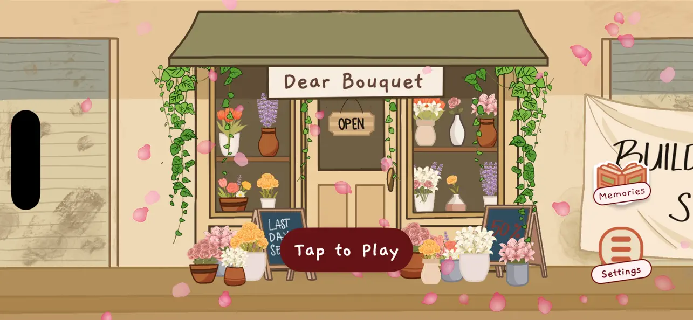

# Dear Bouquet




Dear Bouquet is an immersive narrative iOS game that transports players into the world of floriography, the language of flowers. Step into the shoes of Maria, a florist who creates meaningful bouquets for customers while discovering emotional stories and the hidden meanings behind each bloom. Combine beautiful flowers to craft personalized bouquets that convey the perfect emotions for each unique customer story.

## Features

- **Narrative-Driven Gameplay:** Experience heartfelt stories through visual novel-style dialogue scenes with customers visiting Maria's flower shop
- **Bouquet Crafting:** Drag-and-drop flower arrangement system using SpriteKit with freeform placement, rotation, and layering
- **Floriography Learning:** Discover the language of flowers through an interactive flower book/dictionary with meanings and symbolism
- **Character Stories:** Meet diverse characters including Robert, Abigail, and Michael, each with their own emotional journeys
- **Memory Collection:** Save your completed bouquets and revisit past customer stories in the Memories album
- **Beautiful Animations:** Falling petals, smooth transitions, and animated loading screens create an atmospheric experience
- **Progress Persistence:** SwiftData integration ensures your story progress and completed bouquets are saved automatically

## Tech Stack


- **Swift** as the programming language
- **SwiftUI** for the user interface and navigation
- **SpriteKit** for the bouquet crafting game scene with drag-and-drop mechanics
- **SwiftData** for local data persistence (story progress, completed stories, dialogue history)
- **AVFoundation** for audio playback (background music and sound effects)
- **JSON** for story data storage and parsing
- **MVVM Architecture** for clean, maintainable code structure

## Requirements

- iOS 17.0+
- Xcode 15.0+
- Swift 5.9+

## Installation

### Prerequisites

- Xcode 15.0 or later
- iOS 17.0 or later
- macOS Ventura or later (for development)
- Active Apple Developer account (for deployment)

### Steps

1. **Clone Repository:**

```bash
git clone https://github.com/LiftUpCircle/florist-spritekit.git
```

2. **Open Project in Xcode:**

```bash
cd florist-spritekit
open florist.xcodeproj
```

3. **Build and Run:**

Select your target iPhone device or simulator and press ⌘+R to build and run the application.

4. **Device Orientation:**

The app is locked to landscape orientation for optimal gameplay experience.

## Project Structure

```plaintext
florist/
├── florist/
│   ├── FloristApp.swift                    # App entry point with SwiftData setup
│   ├── AppDelegate.swift                   # UIKit delegate for orientation lock
│   ├── GameFlowCoordinator.swift           # Navigation and game flow management
│   ├── GameProgressManager.swift           # Story progression tracking
│   ├── StoryCompletionDialog.swift         # Story completion UI
│   ├── ToBeContinuedView.swift             # End of chapter screen
│   ├── Assets.xcassets/                    # Images, colors, and app icons
│   ├── AudioResources/                     # Background music and sound effects
│   ├── Fonts/                              # Custom Gaegu font files
│   ├── BouquetPage/                        # Bouquet crafting feature
│   │   ├── GameScene.swift                 # SpriteKit scene for flower arrangement
│   │   ├── BouquetViewController.swift     # SpriteKit view controller
│   │   ├── BouquetModel.swift              # Bouquet data model
│   │   ├── BouquetSlot.swift               # Flower slot management
│   │   ├── FlowerData.swift                # Flower properties and emotions
│   │   ├── HintBoxView.swift               # Tutorial hints UI
│   │   └── BouquetTutorialManager.swift    # First-time user guidance
│   ├── ListeningPage/                      # Visual novel dialogue system
│   │   ├── Views/
│   │   │   ├── ListeningPageView.swift     # Main dialogue view
│   │   │   ├── VNSceneView.swift           # Visual novel scene rendering
│   │   │   ├── DialogueTextBoxView.swift   # Typewriter text animation
│   │   │   ├── CharacterSpriteView.swift   # Character display
│   │   │   └── DialogueHistoryView.swift   # Past dialogue review
│   │   ├── Models/
│   │   │   ├── StoryManager.swift          # JSON story loader
│   │   │   ├── StoryData.swift             # Story data structures
│   │   │   ├── StoryScene.swift            # Scene definitions
│   │   │   └── DialogueEntry.swift         # Dialogue data model
│   │   ├── ViewModel/
│   │   │   └── TypewriterViewModel.swift   # Typewriter animation logic
│   │   └── Controller/
│   │       └── StoryController.swift       # Story flow control
│   ├── FlowerBookPage/                     # Floriography dictionary
│   │   └── Views/
│   │       ├── FlowerBookView.swift        # Flower book UI
│   │       ├── FlowerSidebarView.swift     # Flower selection
│   │       └── BookContentView.swift       # Flower details display
│   ├── MainMenuPage/                       # Main menu
│   │   └── MainMenuView.swift              # Landing screen with play button
│   ├── MemoriesPage/                       # Saved bouquets gallery
│   │   └── MemoriesView.swift              # Memory album interface
│   ├── SplashScreen/                       # App launch screen
│   │   └── SplashScreenView.swift          # Animated splash with wave text
│   ├── Persistence/                        # Data persistence layer
│   │   ├── StoryProgress.swift             # Progress data model
│   │   ├── CompletedStory.swift            # Completed story model
│   │   ├── DialogueHistoryEntry.swift      # Dialogue history model
│   │   ├── ProgressPersistenceManager.swift # Persistence coordinator
│   │   └── SchemaVersioning.swift          # SwiftData migrations
│   ├── Components/                         # Reusable UI components
│   │   └── ToastView.swift                 # Toast notifications
│   ├── DesignSystem/                       # Typography and colors
│   ├── ResetConfirmation/                  # Game reset modal
│   └── settings-overlay/                   # Settings menu
└── florist.xcodeproj/                      # Xcode project configuration
```

## Key Components

### Game Flow

- **GameFlowCoordinator**: Manages navigation between main menu, dialogue scenes, bouquet crafting, and memories
- **GameProgressManager**: Tracks player progress through stories with save/restore functionality
- **StoryManager**: Loads and parses JSON story files for the visual novel system

### Bouquet Crafting Engine

- **GameScene (SpriteKit)**: Handles drag-and-drop flower placement with touch gestures
- **FlowerNode**: Custom SKSpriteNode for individual flowers with rotation and layering
- **BouquetTutorialManager**: First-time player guidance with contextual hints

### Visual Novel System

- **StoryController**: Controls dialogue progression and scene transitions
- **TypewriterViewModel**: Animates text reveal with typewriter effect
- **DialogueHistoryView**: Allows players to review past conversations

### Data Persistence

- **SwiftData Integration**: Automatic persistence of story progress, completed stories, and dialogue history
- **Schema Versioning**: Migration support for app updates
- **ProgressPersistenceManager**: Centralized persistence coordination

## Usage

1. **Splash Screen:** Watch the animated "Dear Bouquet" title on app launch
2. **Main Menu:** Tap "Tap to Play" to begin or continue your journey
3. **Dialogue Scenes:** Tap to advance through customer stories and learn about their needs
4. **Bouquet Crafting:** Drag flowers from the inventory onto the bouquet canvas
   - Rotate flowers by dragging the rotation control
   - Reorder layers using bring-to-front/send-to-back buttons
   - Mirror the flower to make it looks good using mirror button
5. **Complete Stories:** Wrap your bouquet to complete the customer's order
6. **Memories:** Revisit completed bouquets and stories in the Memories album
7. **Settings:** Adjust music, sound effects, and other preferences

## Flower Emotions Guide

| Flower    | Primary Emotion | Meaning                         |
| --------- | --------------- | ------------------------------- |
| Rose      | Love            | Deep affection and romance      |
| Jasmine   | Joy             | Happiness and sweetness         |
| Lavender  | Calm            | Serenity and tranquility        |
| Carnation | Gratitude       | Appreciation and admiration     |
| Lily      | Purity          | Innocence and sympathy          |
| Tulip     | Hope            | New beginnings and perfect love |

## Contributing

Contributions are welcome! Please feel free to submit a Pull Request.

1. Fork the repository
2. Create your feature branch (`git checkout -b feature/amazing-feature`)
3. Commit your changes (`git commit -m 'Add some amazing feature'`)
4. Push to the branch (`git push origin feature/amazing-feature`)
5. Open a Pull Request

## License

This project is licensed under the MIT License - see the [LICENSE](LICENSE) file for details.

## Acknowledgments

- Apple Developer Documentation for SwiftUI, SpriteKit, and SwiftData frameworks
- Our mentors Ko Har, Karima, and Ko Daniel for guidance and feedback during development
- Beta testers who provided valuable feedback
- ChatGPT, Claude, and other LLM for assisting in brainstorming, development, and documentation

## Contributors

<a href="https://github.com/LiftUpCircle/florist-spritekit/graphs/contributors">
    
</a>

---

> _"Every flower tells a story. Every bouquet speaks from the heart."_
>
> Discover the art of floriography and create meaningful connections through the timeless language of flowers.
